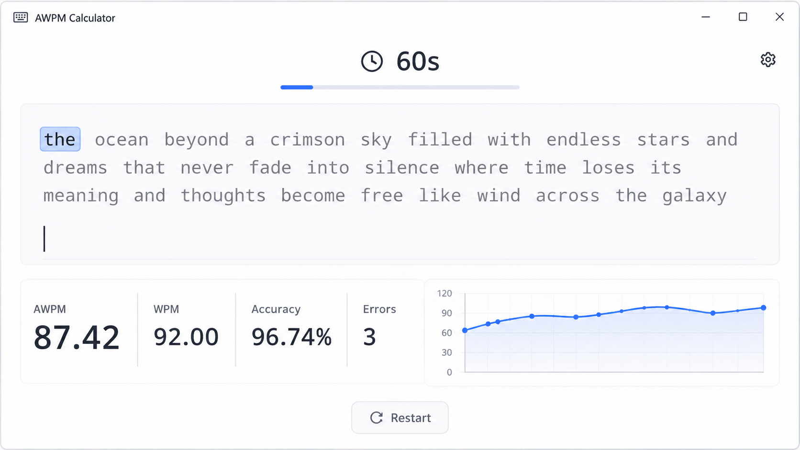

# AWPM Calculator

A minimalist Monkeytype-inspired typing speed test built completely with Java Swing and Java2D.

## Features

- Random word typing tests
- Real-time typing feedback
- WPM and AWPM calculation
- Accuracy tracking
- Error detection
- Live performance graph
- Configurable test duration
- Lightweight single-file Java application

## Preview

## Technologies

- Java
- Swing
- Java2D
- AWT

## Run

Compile:

javac AWPMCalculator.java

Run:

java AWPMCalculator

## Formula

WPM:

(chars typed / 5) / minutes

AWPM:

(WPM adjusted based on typing errors)

## License

MIT
